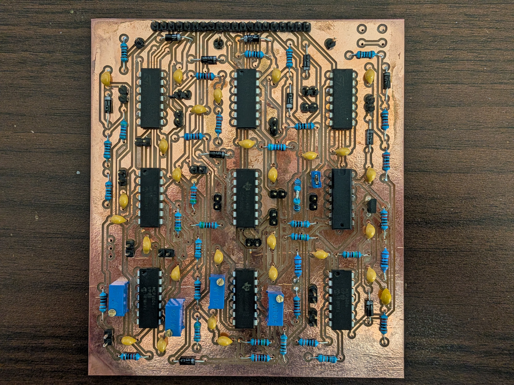
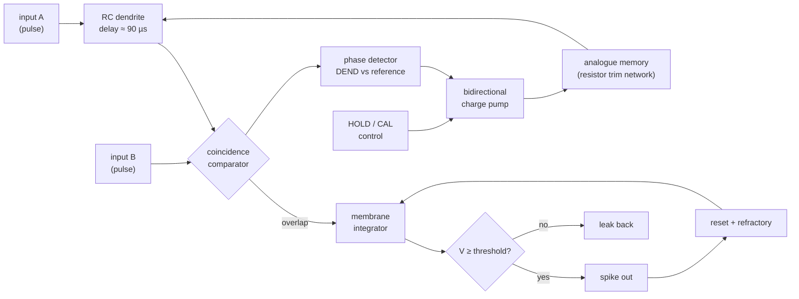
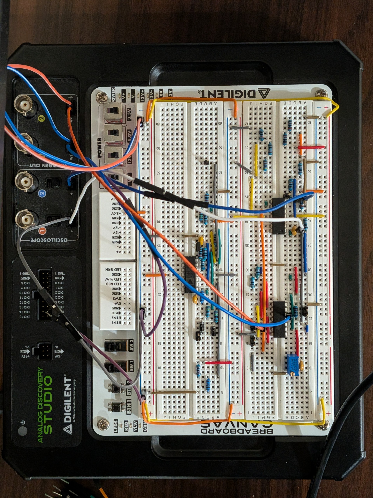
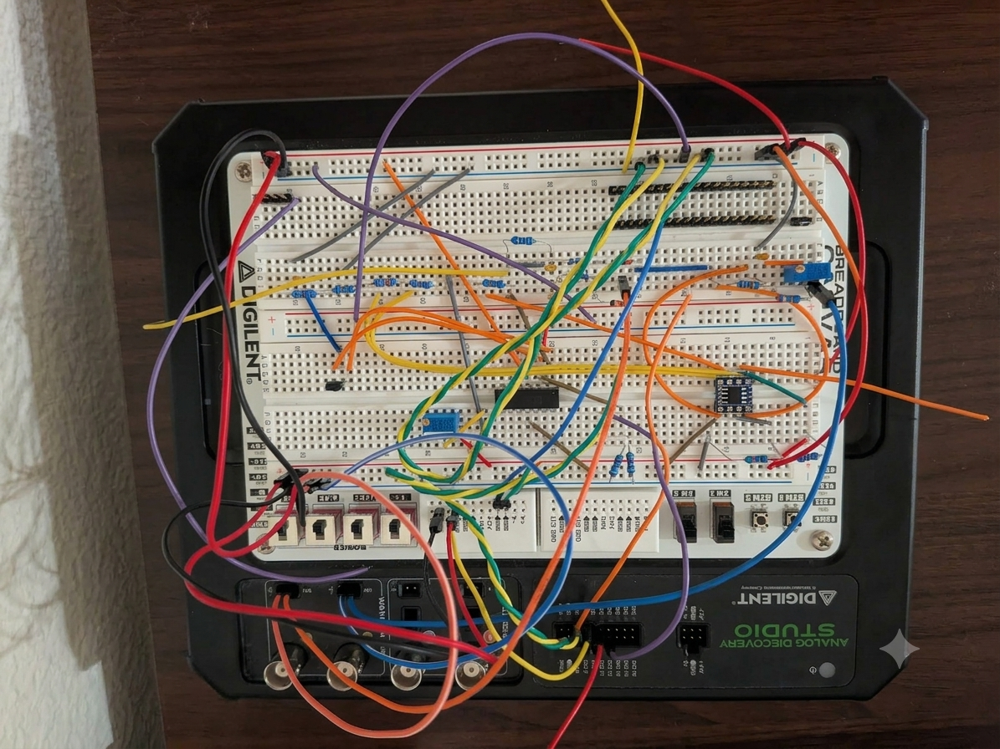
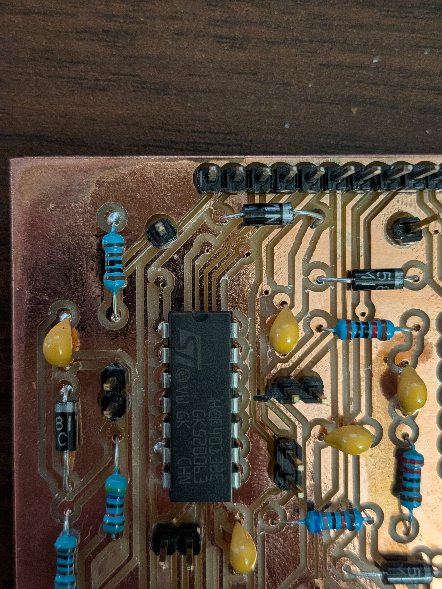
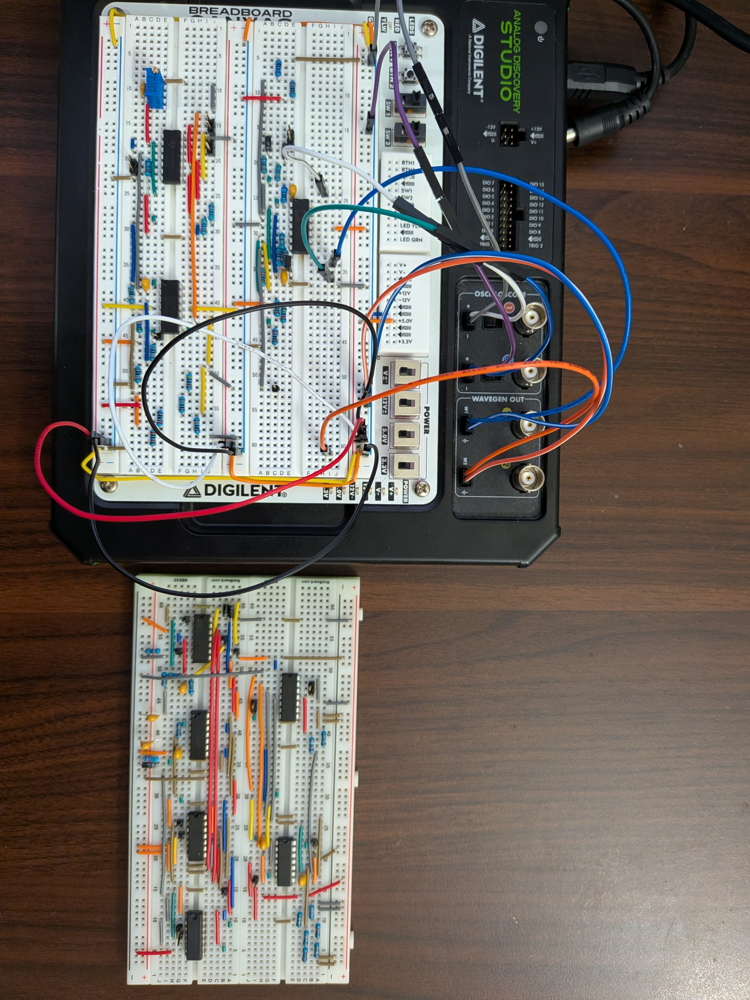
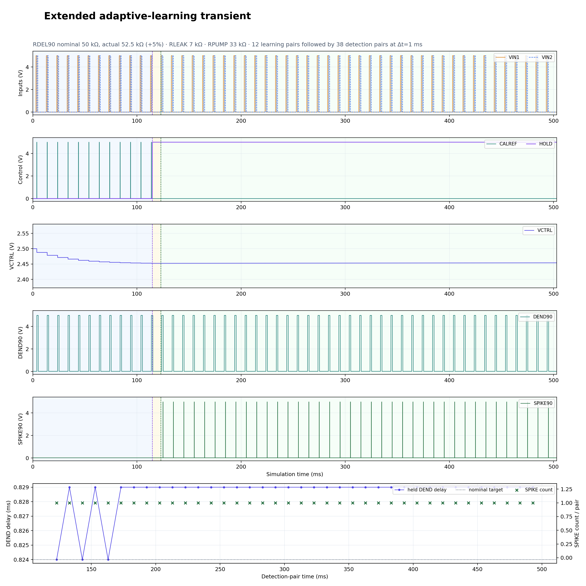
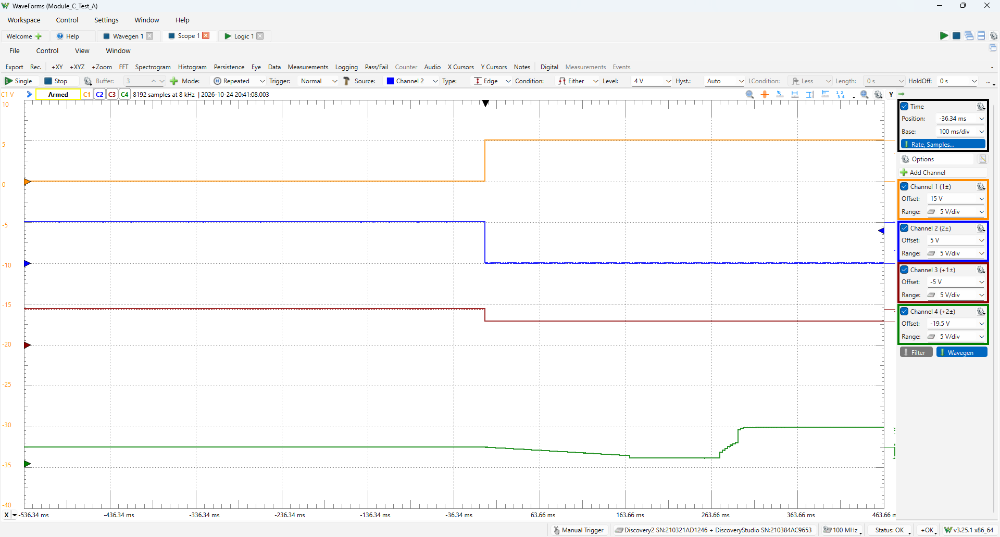
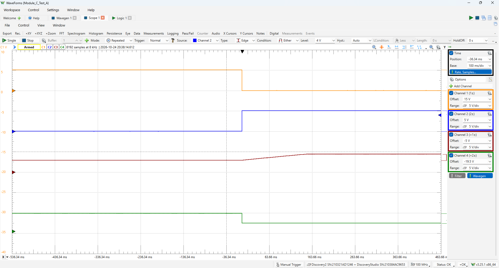

# Neuron-90 — an RRAM-coupled spiking coincidence neuron, built and measured

  

  
  
  
  

A single analogue neuron that fires when **two input spikes arrive within a ~90 µs window**, built
from commodity logic and op-amps, hand-routed as a milled two-layer board, and characterised on a
bench with a Digilent Analog Discovery Studio. Around the neuron sits a **delay-locking loop** that
trims its internal dendrite delay until it matches a reference pair, and holds the learned value as
an analogue state — the seat where a **resistive RAM (RRAM)** element is meant to live.

This repository is the *public* face of that work: the background, the concept, the build, and the
measurements. The design sources themselves are not published (see **Repository scope**).

---

## Table of contents

1. [Repository scope](#repository-scope)
2. [Background I — what RRAM is, and why neuromorphic engineers want it](#background-i--what-rram-is-and-why-neuromorphic-engineers-want-it)
3. [Background II — spiking neural networks in one page](#background-ii--spiking-neural-networks-in-one-page)
4. [System concept](#system-concept)
5. [Build gallery](#build-gallery)
6. [Results: simulation and measurement](#results-simulation-and-measurement)
7. [Verification ladder](#verification-ladder)
8. [Bench, instruments and toolchain](#bench-instruments-and-toolchain)
9. [Data conventions](#data-conventions)
10. [Honest limitations](#honest-limitations)
11. [Roadmap](#roadmap)
12. [Related repositories](#related-repositories)
13. [References](#references)
14. [中文速览](#中文速览)

---

## Repository scope

| Published here | Intentionally withheld |
| --- | --- |
| Bench photographs of the prototypes and the assembled board | Schematic sheets and SPICE netlists |
| Measured scope captures and simulation transients | PCB layout, copper artwork, Gerbers, drill files |
| The explanatory material in this README | Bill of materials, assembly drawings, probe maps |
| Device-level results from the RRAM characterisation bench | Measurement tooling source code |

Everything you can *see* here came out of `07_Experiment_Media` of the private build archive.
Anything that could be used to *rebuild* the circuit — schematics, layout, netlists, BOM — stays
private. That is a deliberate split: the physics and the results are the contribution; the artwork
is not a giveaway. If you need design-level access for review, collaboration or licensing, make
contact.

**One caveat, stated up front:** this board is *RRAM-ready*, not *RRAM-integrated*. The learned
delay state is presently held as charge on a capacitor, refreshed by a charge pump, which is an
analogue memory but not a non-volatile one. The RRAM devices themselves are characterised on the
same bench as a separate campaign; co-integrating a 1T1R element into the loop is the next step, not
a finished claim.

## Background I — what RRAM is, and why neuromorphic engineers want it

### The device

A resistive RAM cell is embarrassingly simple: a **metal / oxide / metal** stack, typically
10–50 nm of a transition-metal oxide such as HfO₂, TaO_x, AlO_x or TiO_x, sandwiched between an
inert electrode (Pt, Ru, TiN) and an oxidisable one (Ti, Ta, Hf, Al). No transistor is needed to
*store* the bit — the state is a resistance, and it survives power-off.

The resistance change is filamentary. A fresh cell is highly insulating; a one-off **forming** step
(applied with a current compliance) creates a nanoscale oxygen-vacancy chain through the oxide.
That filament is the low-resistance state (LRS, "ON"). Applying a voltage of opposite polarity
drives oxygen ions back and ruptures the filament near the electrode — high-resistance state (HRS,
"OFF"). Because one polarity sets and the other resets, the device is **bipolar**, and the switching
is usually described as *valence-change* (VCM) or, when the mobile species is a metal cation from an
active electrode (Ag, Cu), *electrochemical metallisation* (ECM).

Three properties follow from that picture, and all three matter here:

1. **The state is analogue, not binary.** Stop the SET pulse halfway and the filament is partially
   formed: the cell lands on an intermediate conductance. A train of identical pulses walks the
   conductance up or down in steps, which is exactly what a synaptic weight needs.
2. **The state is local.** Computation can happen *at* the stored value — Kirchhoff's and Ohm's laws
   multiply and sum on a crossbar, with no data movement between memory and ALU.
3. **The state is physical, therefore noisy.** Filament growth is stochastic, so programming is
   probabilistic, and retention drifts because oxygen ions keep moving.

### Numbers that define a cell

| Parameter | Typical range in the literature | Why it matters for a synapse |
| --- | --- | --- |
| ON/OFF window | 10× – 10⁴× | Dynamic range of a weight |
| Switching voltage | 0.3 – 3 V | Compatibility with CMOS logic levels |
| Switching speed | 10 ns – 1 µs | Spike-timing resolution |
| Endurance | 10⁶ – 10¹² cycles | Learning lifetime |
| Retention (85 °C) | 10⁴ s – 10 years | Non-volatile inference |
| Analogue levels | 8 – 100+ | Weight precision before calibration |
| Cell area | 4F² (crossbar) – 40F² (1T1R) | Density per synapse |

### Where it wins, and where it hurts

| Attribute | SRAM | DRAM | Flash | **RRAM** |
| --- | --- | --- | --- | --- |
| Non-volatile | ✗ | ✗ | ✓ | ✓ |
| Analogue weight update | ± (charge) | ± | ± (coarse) | **+** |
| Write energy per bit | low | low | high (10–100 pJ) | **~pJ** |
| Back-end-of-line integration | ✗ | ✗ | ✗ | **✓** |
| Endurance | ∞ | ∞ | 10⁴–10⁵ | 10⁶–10¹² |
| Variability / need for write-verify | — | — | medium | **high** |
| Maturity | mature | mature | mature | pilot production |

The costs are real and this project takes them seriously: **non-linearity** (a pulse train does not
move conductance linearly), **asymmetry** (potentiation and depression are not mirror images),
**cycle-to-cycle and device-to-device spread** (often 20–50 % in HfO₂), and **drift** (the state
relaxes after programming). Practical systems answer with 1T1R cells, write-verify loops, differential
pairs, or — as here — a closed-loop analogue controller that trims the observable behaviour rather
than trusting the programmed value.

### RRAM's role in this project

Two roles, one present and one pending:

* **Present:** the neuron is designed to accept an external two-terminal resistive device in the
  synaptic branch, and the device characterisation bench (SET/RESET sweeps, incremental-pulse
  programming, read-disturb trains, retention logging) was built to supply real conductance data to
  the models rather than textbook placeholders.
* **Pending:** the delay-locking loop's analogue state currently lives on a capacitor and is
  refreshed by a charge pump. A capacitor is a fine *analogue* memory and a poor *non-volatile* one:
  it holds for seconds to minutes, then leaks. Replacing it with a 1T1R element turns "learns and
  forgets" into "learns and keeps", at the price of all the variability above. The loop was
  deliberately written so that the storage element is the only part that has to change.

## Background II — spiking neural networks in one page

### Spikes, not numbers

A spiking neural network (SNN) is the third generation of artificial neural network models: the
signal is not a floating-point activation but a **binary event in time**. A neuron accumulates
charge, and when its membrane potential crosses a threshold it emits a spike — a 1 ms-ish pulse —
then resets and goes briefly refractory. Nothing is transmitted while a neuron is silent, so
energy scales with *activity*, not with network size.

That shift buys three things: temporal precision (a spike's arrival time can carry information to
microsecond resolution), sparsity (typical cortical firing rates are 1–10 Hz, so the average wire is
idle), and locality of learning (plasticity depends only on pre- and post-synaptic timing).

### The leaky integrate-and-fire model

The workhorse model, and the one this board implements in analogue form:

$$
\tau_m \frac{dV_m}{dt} = -\left(V_m - V_{rest}\right) + R_m I(t),
\qquad
V_m \ge V_{th} \Rightarrow \text{spike},\; V_m \leftarrow V_{reset},\; t < t_{ref}
$$

The time constant τ_m = R_m C_m sets the memory of the neuron; the leak term is why an input that
arrives too late is partially discounted. Everything macroscopic about the neuron — threshold,
leak, refractory period, delay — is a physical R, C or comparator reference here, not a float.

### Temporal coding and coincidence detection

If timing carries information, then the elementary computation is not "sum the inputs" but
"**detect that these inputs agree**". Two variants matter:

* **Coincidence detection** — fire only when inputs land inside a window Δt. This is how the medial
  superior olive resolves interaural time differences of tens of microseconds: a *delay line* of
  axons plus a *coincidence cell* per angular direction (the Jeffress model). Silicon copies of it
  are called a delay-line coincidence detector.
* **Delay/phase coding** — each synapse carries a delay; a cell is selective to a specific
  spatio-temporal pattern. Pattern recognition becomes a matched filter in the time domain.

In both cases the design parameters are the *delay* and the *window*, which is precisely what this
board makes visible, trimmable and measurable: an RC dendrite defines the delay, a comparator pair
defines the window, and a spike appears only for the matching pulsing interval.

### Plasticity, and why it maps onto RRAM

Synaptic weights in an SNN are rarely set by backpropagation. The biological rule is timing-based:

$$
\Delta w =
\begin{cases}
A_{+} \exp\left(-\dfrac{\Delta t}{\tau_{+}}\right), & \Delta t > 0 \quad \text{(pre before post)}\\[4pt]
-A_{-} \exp\left(\dfrac{\Delta t}{\tau_{-}}\right), & \Delta t < 0 \quad \text{(post before pre)}
\end{cases}
$$

This is spike-timing-dependent plasticity (STDP): causal pairs potentiate, acausal pairs depress, and
the kernel is exponential with a ~10–20 ms time constant. Implemented in hardware it needs a
*stateful, incrementally writable analogue weight* — the exact job description of a resistive RAM
cell. That is the link between the two halves of this project: **RRAM is interesting to SNN people
because STDP is an analogue, local, incremental update, and RRAM is an analogue, local, incremental
memory.**

### How the hardware options compare

| Approach | Neuron | Synapse | Strength | Weakness |
| --- | --- | --- | --- | --- |
| Digital many-core (SpiNNaker, Loihi, TrueNorth) | fixed-point / bit-serial | SRAM weight table | exact, scalable, tooling | energy per spike, no device physics |
| Subthreshold analogue CMOS (Indiveri-style) | few-transistor LIF | capacitor or current mirror | µW per neuron, native time constants | mismatch, limited weight retention |
| Memristive crossbar | CMOS neuron | 1T1R / 1R at the crosspoint | dense, in-memory MAC, non-volatile | IR drop, variability, write circuitry |
| **This work** | discrete analogue LIF-equivalent | external resistive device + analogue capacitive trim | observable, teachable, every node probeable | board-scale, drift, hand-built |

The last row is honest about what it is: a *physical instrument for one neuron*, sized so that every
internal node can be scoped. You cannot debug a crossbar's learning rule if you have never watched a
single analogue neuron lock onto a timing reference.

## System concept

Two logic-level pulses arrive on separate inputs. One of them is stretched by an RC **dendrite** so
that its edge arrives ~90 µs late; a comparator pair then asks whether the two edges overlap inside
the acceptance window. If they do, the membrane node charges, crosses its threshold, and the neuron
emits a **spike**; if the second pulse is early or late, the membrane is nudged but never reaches
threshold, and the neuron stays silent. That is coincidence detection with a physical, scopable
window — no clock, no counter, no firmware in the decision path.

The loop on the right is what makes this more than a one-shot comparator. A **phase detector**
compares the dendrite edge against a reference edge and drives a **charge pump** that walks the
delay-setting node up or down, trimming the RC delay until the two agree. Once locked, the control
input freezes the node and the learned delay is held. This is a delay-locked loop with an analogue
memory in the loop filter — the exact place where a non-volatile device belongs, and the reason the
board is described as RRAM-ready.

### Functional blocks

| Block | Job | How it is checked |
| --- | --- | --- |
| Dendrite (RC + buffer) | Turn a pulse edge into a calibrated delay | Edge-to-edge timing on the scope; SPICE transient match |
| Coincidence comparator | Decide "inside the window / outside" | Sweep Δt across the window and log spike / no-spike |
| Membrane integrator | Accumulate coincidences, leak between them | Node voltage probed on the 20-node harness |
| Threshold + spike shaper | Clean digital output pulse | Logic analyser and scope channel |
| Reset / refractory | Return the membrane below threshold | Recovery time measured after each spike |
| Phase detector + charge pump | Measure the delay error and correct it | Loop transient: error vs number of pairs |
| Analogue memory / HOLD | Store the learned delay | Drift after HOLD, over minutes |
| Reference / bias network | Supply all thresholds | Static node check at power-up |

### Design targets

| Quantity | Target | Why that number |
| --- | --- | --- |
| Coincidence window | ≈ 90 µs | Delay-line scale where RC tolerances dominate but stay trimmable |
| Input pulse width | millisecond-scale | Comfortably longer than the window; edges, not widths, carry the timing |
| Supply | single 5 V rail | Commodity logic + rail-to-rail op-amps, no bipolar rails |
| Spike output | 0–5 V, fan-out to logic | Directly readable by a scope and by downstream counters |
| Board | two-layer, milled in-house | Fast iteration: a layout change is an afternoon, not a fab run |

Nothing in the decision path needs a microcontroller. The correctness of the neuron is therefore
falsifiable with a two-channel scope and a pulse generator — which is exactly how it was validated.

## Build gallery

The build went through three physical stages: breadboard, milled board, and the two-board bench
stack that is used for measurement. The breadboard is not nostalgia — it is where the comparator
window and the dendrite delay were first seen to behave, before any artwork existed.

<table>
<tr>
<td width="50%"> 
<b>Prototype, stage 1.</b> The whole neuron on a solderless breadboard, with the Analog Discovery
Studio supplying both the pulse trains and the rails. Every node is reachable, which is why the first
timing measurements were taken here.</td>
<td width="50%"> 
<b>Prototype in harness.</b> Flying leads from the instrument's waveform outputs into the
dendrite and comparator inputs; scope channels tapped on the membrane node and the spike output.</td>
</tr>
<tr>
<td width="50%"> 
<b>Stage 2.</b> The hand-milled two-layer board, populated and ready to be powered. Same
topology as the breadboard, but with the timing components now in fixed positions, so the delay
distribution is a property of the board rather than of jumper length.</td>
<td width="50%"> 
<b>Detail.</b> A macro look at one logic package and its local passives. Hand-milled boards
have visible tooling marks and wider tolerance than a fab board — the calibration loop exists partly
because of exactly this.</td>
</tr>
</table>

   
  <b>Stage 3 — the measurement configuration.</b> The neuron board sits on the instrument's
  breadboard area and a second board carries the probe/interface wiring. This is the arrangement used
  for the final captures below: one instrument generating the pulse pair, four scope channels
  recording the internal nodes.

## Results: simulation and measurement

Two different kinds of evidence appear below, and the difference matters: one figure is a **re-plot of
samples exported from the circuit simulation**, the other two are **raw oscilloscope screen captures**.
They are labelled as such in every caption and in `media/README.md`, because a clean matplotlib panel and
a 100 ms/div scope grab answer different questions — the first says the mechanism works as modelled, the
second says the copper does too.

### Simulated transient: the loop converges, then holds

  

**This is a simulation, not a scope capture.** The plot was rendered from samples exported by the
circuit simulation (`R_DEM90` nominal 50 kΩ against 52.5 kΩ as-built, i.e. +5 %; `R_LEAK` 7 kΩ;
`R_PUMP` 33 kΩ), so both axes are model quantities. It is included because it is the only view that
covers the loop's whole arc — convergence, HOLD and 38 post-HOLD detection pairs — in one frame. The
measured counterpart is the pair of screen captures in the next subsection.

One long transient, six stacked traces, 500 ms of simulated activity: the input pair, the calibration/HOLD
control, the delay-control node `VCTRL`, the dendrite output `DEND90`, the spike output `SPIKE90`,
and the extracted delay next to the per-pair spike count. Read it left to right:

* **0–120 ms — learning.** Twelve input pairs are applied to the model. `VCTRL` steps *downward* pair
  by pair: the charge pump is removing delay-setting resistance because the modelled dendrite edge is
  late against the reference. `DEND90` delay falls with it, in visible steps of about 0.4 ms total.
* **120 ms — HOLD asserted.** The pump stops, the node freezes, and from here on the delay is a
  stored analogue value, not a servo output.
* **120–500 ms — detection.** Thirty-eight pairs at a fixed Δt = 1 ms follow. The spike count per pair
  is exactly 1 for every pair, and the extracted delay stays inside the ±0.3 % band around the nominal
  target without any further correction.

In simulation, that last panel is the point of the whole exercise: the loop does not just converge, it
*stays* converged once the control input stops driving it. What the model does not capture is the part
the bench captures show: leakage, offset shifts and part-to-part variation on the storage node. The
residual error here is set by the resolution of the charge pump, not by the initial resistor tolerance —
which is exactly what a real RRAM-backed version would have to reproduce with a much noisier storage
element.

### Final bench captures, two builds

<table>
<tr>
<td width="50%"> 
<b>Earlier revision (`EARLY`)</b> — raw capture at 20:41. Four probe channels, 5 V/div, 100 ms/div, 8192 samples
at 8 kHz. Note the disturbance on the slow channel immediately after the control edge: it recovers,
but it is the kind of artefact a downstream integrator would happily integrate.</td>
<td width="50%"> 
<b>Revised assembly (`LATE`)</b> — raw capture at 20:38. Probe polarity and channel offsets
were re-set between runs, so absolutes are not comparable; the shapes are. Each channel now makes a
single transition, and the slow channel settles smoothly instead of glitching first.</td>
</tr>
</table>

`EARLY` and `LATE` name the module-C circuit revision, not the capture order: by the on-screen
timestamps the revised assembly was captured first (20:38:14) and the earlier revision at 20:41:08.
Both are Digilent WaveForms screenshots — 100 ms/div, 5 V/div, 8192 samples at 8 kHz — not re-plots.

These are deliberately unglamorous captures. A single-neuron board is only worth building if its
internal nodes can be watched during a control step, and a screenshot of four channels at 100 ms/div
is the honest form of that evidence. What the zoomed-out view shows is settling behaviour: after the
control edge, each node moves to its new operating point and stays there instead of creeping.

## Verification ladder

Nothing here was accepted because it simulated well. Each claim climbed four rungs, and a claim that
only reached rung 1 is labelled as such everywhere in this README.

| Rung | What is checked | Pass condition | Failure that actually happened |
| --- | --- | --- | --- |
| 1. Netlist | Transient response of the full neuron over a swept Δt, with realistic op-amp and switch models | Spike for Δt inside the window, silence outside, monotonic edges | Ideal-model sims predicted a window that real parts did not deliver |
| 2. Breadboard | Same sweep, measured on the instrument | Window centre within ~10 % of the target, one spike per coincidence | Comparator offsets from unmatched resistor dividers pushed the window |
| 3. Milled board | Same sweep on copper, twice (early and late assemblies) | Reproducible spike/silence decision, no chatter | Mill tolerances shifted the delay; needed the trim network |
| 4. Loop + HOLD | 500 ms transient with the calibration loop enabled, then frozen | Error decreases per pair, delay holds inside a narrow band, one spike per detection pair | Leakage on the analogue memory moved the delay between runs. Ladder rung reached in **simulation** — the published transient is a re-plot; on the bench only the control step itself was captured |

Two habits made the ladder useful. First, the sweep is always the same script — the same Δt list, the
same pulse shape — so a difference between rungs is a difference in the hardware, not in the test.
Second, every rung records the *silent* cases as carefully as the spiking ones: a coincidence detector
that fires when it should not is worse than one that never fires.

## Bench, instruments and toolchain

| Element | What was used | Role |
| --- | --- | --- |
| Mixed-signal instrument | Digilent Analog Discovery Studio (with a Discovery 2 class scope engine) | Generates the pulse pair, records up to four nodes |
| Scope software | Digilent WaveForms (3.25.x) | Raw captures, cursors, export |
| Measurement app | In-house dual-instrument scope tool with a 20-node probe map | Repeatable node-by-node checks, CSV logging |
| Waveform synthesis | Python generators for pulse pairs, trains and STDP-shaped pairs | Deterministic stimuli, versioned parameters |
| Circuit simulation | PSpice-compatible netlists (also run under ngspice) | Rung 1 of the ladder |
| Board fabrication | In-house milling, two layers | Fast layout iteration |
| Device bench | Source-measure sweeps, pulse programming, read trains | RRAM SET/RESET and analogue-programming data |

The probe map deserves a sentence of its own: twenty named nodes, each with an expected DC value and
an expected transient signature. Checking them in order takes about a minute and catches the two
failure modes that dominate hand-built analogue boards — a wrong bias divider and a cold joint.

## Data conventions

* **Original filenames are preserved** from the build archive, including camera names and timestamps.
  They are ugly but traceable; renaming them would break the link to the lab notebook.
* **Simulation and measurement are never blended.** A plotted transient that came out of a simulator
  is a simulation, even when it is plotted in the same style as a scope capture.
* **No cosmetic smoothing.** Scope screenshots are published as captured. Where a figure is a
  re-plot, it is a re-plot of exported samples, and the axes carry the units.
* **Time bases are stated.** `100 ms/div` on a capture means the whole screen is ~1 s of activity;
  a delay quoted in microseconds is measured with cursors, not eyeballed from the zoomed-out view.
* **"Learned" means the loop closed**, not that the device is non-volatile. The distinction is kept
  in the wording throughout: the state is *held*, and it will leak.

## Honest limitations

* **One neuron, not a network.** Everything here is a single coincidence cell. Scaling claims would
  need a shared reference distribution, crosstalk measurements and a fan-out study, none of which
  exist yet.
* **The memory is volatile.** The learned delay lives on a capacitor refreshed by a charge pump.
  Between runs the state relaxes; the "retention" of this board is seconds to minutes, not years.
* **The RRAM device is off-board.** Device characterisation and neuron measurement happen on the
  same bench but not in the same circuit. Any sentence that sounds like "RRAM synapse demonstrated"
  would be an overclaim, so the wording throughout is "RRAM-ready".
* **Tolerance is dominated by passives.** Window centre and delay both depend on resistor and
  capacitor tolerance; the trim network corrects the delay, not the comparator offset.
* **Hand-milled copper.** Two layers, wide features, no solder mask, no impedance control. It works
  at these speeds, and it would not work at 10× the frequency.
* **Measurement resolution is stated, not implied.** The published scope captures are at 100 ms/div;
  they show settling behaviour, not microsecond edge timing.
* **Room temperature, single unit.** No temperature sweep, no batch statistics, no ageing study.

## Roadmap

| Next step | Why | Success test |
| --- | --- | --- |
| Replace the loop-filter capacitor with a 1T1R element | Make the learned delay non-volatile | Delay within the same band after 10 minutes of power-off |
| Add a write-verify wrapper around programming | Live with RRAM variability instead of ignoring it | Converged delay with ≤ 5 programming pulses per pair |
| Bank of 8–16 neurons sharing one reference | Move from a cell to a layer | Independent windows, measured crosstalk below a stated bound |
| On-board STDP pair generator | Close the loop between plasticity and delay learning | Pair timing swept from a single control input |
| Automated regression over the 20-node map | Catch assembly faults without a human with a probe | One-command pass/fail report per board |
| Temperature sweep, 10–40 °C | Quantify drift of the analogue state | Published drift coefficient per node |

## Related repositories

| Repository | What it contains |
| --- | --- |
| [`STDP`](https://github.com/ShengLuUTA/STDP) | RRAM–STDP spiking neural network modelled in Cadence Spectre |
| [`SNN_STDP_SPICE`](https://github.com/ShengLuUTA/SNN_STDP_SPICE) | SPICE-level full-circuit simulation of the STDP network |

This repository is the physical sibling of those two: the same ideas taken out of the simulator and
put on copper.

## References

1. D. B. Strukov, G. S. Snider, D. R. Stewart, R. S. Williams, "The missing memristor found",
   *Nature* **453**, 80–83 (2008).
2. R. Waser, M. Aono, "Nanoionics-based resistive switching memories", *Nature Materials* **6**,
   833–840 (2007).
3. H.-S. P. Wong et al., "Metal–oxide RRAM", *Proceedings of the IEEE* **100**(6), 1951–1970 (2012).
4. S. H. Jo, T. Chang, I. Ebong, B. B. Bhadviya, P. Mazumder, W. Lu, "Nanoscale memristor device as
   synapse in neuromorphic systems", *Nano Letters* **10**(4), 1297–1301 (2010).
5. D. Ielmini, H.-S. P. Wong, "In-memory computing with resistive switching devices",
   *Nature Electronics* **1**, 333–343 (2018).
6. A. Sebastian, M. Le Gallo, R. Khaddam-Aljameh, E. Eleftheriou, "Memory devices and applications
   for in-memory computing", *Nature Nanotechnology* **15**, 529–544 (2020).
7. W. Maass, "Networks of spiking neurons: the third generation of neural network models",
   *Neural Networks* **10**(9), 1659–1671 (1997).
8. W. Gerstner, W. M. Kistler, R. Naud, L. Paninski, *Neuronal Dynamics: From Single Neurons to
   Networks and Models of Cognition*, Cambridge University Press (2014).
9. H. Markram, J. Lübke, M. Frotscher, B. Sakmann, "Regulation of synaptic efficacy by coincidence of
   postsynaptic APs and EPSPs", *Science* **275**, 213–215 (1997).
10. G.-Q. Bi, M.-M. Poo, "Synaptic modifications in cultured hippocampal neurons: dependence on spike
    timing, synaptic strength, and postsynaptic cell type", *Journal of Neuroscience* **18**(24),
    10464–10472 (1998).
11. L. A. Jeffress, "A place theory of sound localization", *Journal of Comparative and Physiological
    Psychology* **41**(1), 35–39 (1948).
12. C. Mead, *Analog VLSI and Neural Systems*, Addison-Wesley (1989).
13. G. Indiveri et al., "Neuromorphic silicon neuron circuits", *Frontiers in Neuroscience* **5**:73
    (2011).
14. S. B. Furber, F. Galluppi, S. Temple, L. A. Plana, "The SpiNNaker project", *Proceedings of the
    IEEE* **102**(5), 652–665 (2014).
15. M. Davies et al., "Loihi: a neuromorphic manycore processor with on-chip learning", *IEEE Micro*
    **38**(1), 82–99 (2018).

## 中文速览

**一句话**：一块硬币大小的模拟电路，两个脉冲"同时到"才放电，迟到了就不放电；它还能自己把内部延迟"调"到与参考一致，并把调好的值存起来——那块存值的位置，将来要放 RRAM。

**RRAM 是什么**：金属–氧化物–金属三明治结构，加电压让氧化物里长出一条导电细丝（SET），反向电压把细丝熔断（RESET），于是电阻在高低之间切换。断开电也不丢，所以是非易失的；细丝可以只长一半，所以电阻是连续可调的——这正是"突触权重"需要的东西。代价是器件间差异大、写非线、状态会漂，因此真正做系统时通常要 1T1R + 写校验 + 闭环校准。

**脉冲神经网络是什么**：不用浮点数传递激活值，而是让神经元在膜电位越过阈值时"发一个脉冲"。安静时几乎不耗电，时间精度可以到微秒；学习规则多用 STDP（前后脉冲谁先到决定增强还是削弱）。这类网络最基础的运算之一就是"重合检测"：只有当两路输入在很小的时间窗内先后到达，才认为它们"同意"。

**这块板做了什么**：

1. 用 RC 做"树突"延迟，把一路脉冲拖后约 90 µs；
2. 用比较器判断两路脉冲是否落进同一个窗口，落进才充电、才放电；
3. 用相位检测 + 双向电荷泵构成延迟锁定环，把延迟一步步修到与参考对齐；
4. 拉高 HOLD 后冻结控制节点，学到的延迟就"存"在模拟节点上；
5. 20 个节点全部可探，面包板 → 手刻双面板 → 双板测量台，三级验证。

**得到了什么**：`media/waveforms/` 里的两类证据要分开看，别混。

1. **仿真重绘图** `adaptive_learning_transient_500ms.png`（6 个子图、500 ms 仿真时间）：前 12 对脉冲在"学"，控制节点 `VCTRL` 逐级下移；120 ms 拉高 HOLD 后冻结；之后 38 对检测脉冲每一对都恰好 1 个脉冲，提取出的延迟稳在目标带内不再漂移。纵轴是模型量，**不是示波器截图**。
2. **示波器原始截图** `final_measurement_early.png` / `final_measurement_late.png`：Digilent WaveForms，四通道、100 ms/div、5 V/div、8192 点 @ 8 kHz，看的是控制跳变之后各节点有没有稳定落位、会不会先抖一下再爬。

**仓库边界**：这里只放 `07_Experiment_Media` 里的实验照片与波形结果，以及上面的背景与说明。原理图、网表、PCB 版图、Gerber、BOM、测量工具源码一律不公开；如需评审或合作，请通过 Issue 联系。

**后续**：把环路里的电容换成 1T1R 器件（真正非易失）、加写校验、做 8–16 个神经元的小阵列、上板 STDP 脉冲对生成器、把 20 节点检查做成自动回归。

## Media index

Every figure in this README lives in [`media/`](media/README.md), which also records what each file
is and what it is not. Files are copied unmodified from the build archive; the only processing is
copying.

## License and contact

Text and images: © 2026 Sheng Lu, all rights reserved. Short quotations with attribution are welcome;
redistribution of the media as a dataset, or reuse of the figures in derivative publications, needs
permission. No open-source licence is granted here on purpose — this repository documents a result, it
does not release a design.

Design-level access (schematics, layout, netlists, measurement tooling), collaboration, or review
requests: open an issue on this repository and describe the intended use.

